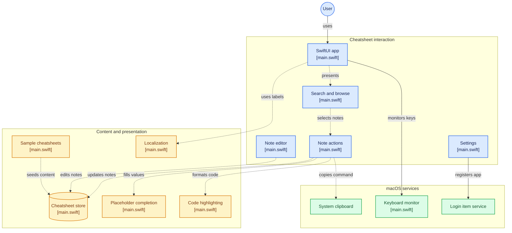

# CheatSheet

Aplikasi menu bar kecil di macOS untuk command yang sering dipakai. Pencet hotkey, cari, isi placeholder kalau ada, salin, lanjut kerja.

> English: lihat [README.md](README.md).

Repo ini adalah fork dari [ahmadazharrivaldy/CheatSheet](https://github.com/ahmadazharrivaldy/CheatSheet). Ide dan kode dasarnya dari sana; fork ini menambahkan perubahan yang dijelaskan di bawah.

## Fitur

- Tinggal di menu bar, buka dengan hotkey global (default `⌃⌥Space`)
- Cari di judul, kategori, dan isi command; filter pakai `#label`
- Placeholder di command seperti `{{nama}}`, `{{nama:default}}`, atau `{{nama:a|b|c}}`, diisi lewat form singkat sebelum disalin
- Syntax highlighting untuk beberapa bahasa umum
- Impor/ekspor sebagai JSON, plus lapisan backup/restore ke iCloud (lihat di bawah)
- UI Bahasa Indonesia dan Inggris

## Instalasi

Butuh Xcode command line tools (untuk `swiftc`) di macOS 14+.

```bash
./build.sh
open CheatSheet.app
```

Perintah ini build dan ad-hoc code-sign `CheatSheet.app` di folder project. Pindahkan ke `/Applications` kalau mau tampil normal dan bisa pakai "Open at Login".

## Data dan backup

Data harian tetap disimpan lokal di `~/Library/Application Support/CheatSheet/cheatsheet.json`, sama seperti versi aslinya, tidak diubah.

Di atas itu, fork ini menambahkan lapisan backup opsional ke iCloud Drive, terpisah dari file lokal:

- Settings → Backup iCloud: pilih Nonaktif, Harian, atau Mingguan, atau langsung klik "Backup sekarang"
- Backup disimpan di `~/Library/Mobile Documents/com~apple~CloudDocs/CheatSheet/Backups/`, 5 terakhir yang disimpan
- "Pulihkan..." menampilkan daftar backup tersebut dan bisa digabung atau menggantikan data yang sedang aktif
- Kalau iCloud Drive tidak tersedia, muncul pesan yang jelas, bukan gagal diam-diam, dan data lokal tidak tersentuh

## Arsitektur

Dibuat oleh [GitDiagram](https://gitdiagram.com/arturafriansyah/cheatsheet) dari struktur source code. Ini ringkasan buatan AI, jadi cek lagi ke kode aslinya untuk hal yang penting.



Versi interaktif: [gitdiagram.com/arturafriansyah/cheatsheet](https://gitdiagram.com/arturafriansyah/cheatsheet)

## Rilis

Push tag seperti `v1.1` memicu GitHub Actions, yang build aplikasi di runner macOS dan melampirkan `.app` yang di-zip ke GitHub Release.

## Lisensi

MIT, sama seperti aslinya. Lihat [LICENSE](LICENSE).
