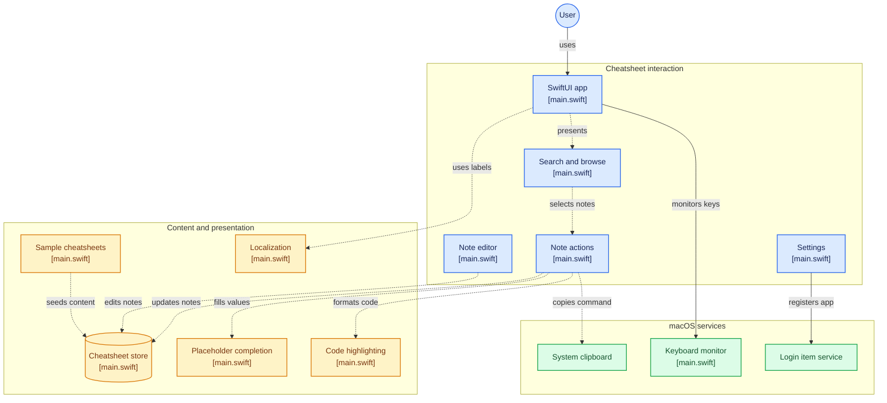

# CheatSheet

A small macOS menu bar app for command snippets. Hit a hotkey, search, fill in a placeholder or two, copy, and get back to work.

> Bahasa Indonesia: see [README.id.md](README.id.md).

This is a fork of [ahmadazharrivaldy/CheatSheet](https://github.com/ahmadazharrivaldy/CheatSheet). All credit for the original idea and codebase goes there; this fork adds the changes described below.

## What it does

- Lives in the menu bar, opens with a global hotkey (default `⌃⌥Space`)
- Search across titles, categories, and command text; filter by `#label`
- Placeholders in commands like `{{name}}`, `{{name:default}}`, or `{{name:a|b|c}}`, filled in a quick form before copying
- Syntax highlighting for a handful of common languages
- Import/export as JSON, and an iCloud backup/restore layer (see below)
- Indonesian and English UI

## Install

Requires Xcode command line tools (for `swiftc`) on macOS 14+.

```bash
./build.sh
open CheatSheet.app
```

This builds and ad-hoc code-signs `CheatSheet.app` in the project folder. Move it to `/Applications` if you want it to show up normally and support "Open at Login".

## Data and backup

Day-to-day data lives locally in `~/Library/Application Support/CheatSheet/cheatsheet.json`. That part hasn't changed from the original.

On top of it, this fork adds an optional backup layer to iCloud Drive, separate from the local file:

- Settings → iCloud backup: choose Off, Daily, or Weekly, or just hit "Back up now"
- Backups land in `~/Library/Mobile Documents/com~apple~CloudDocs/CheatSheet/Backups/`, last 5 kept
- "Restore..." lists those backups and lets you merge or replace your current data
- If iCloud Drive isn't available, you get a clear message instead of a silent failure, and nothing local gets touched

## Architecture

Generated by [GitDiagram](https://gitdiagram.com/arturafriansyah/cheatsheet) from the source tree. It's an AI-made overview, so check it against the code for anything load-bearing.



Interactive version: [gitdiagram.com/arturafriansyah/cheatsheet](https://gitdiagram.com/arturafriansyah/cheatsheet)

## Releases

Pushing a tag like `v1.1` triggers the GitHub Actions workflow, which builds the app on a macOS runner and attaches the zipped `.app` to a GitHub Release.

## License

MIT, same as the original. See [LICENSE](LICENSE).
